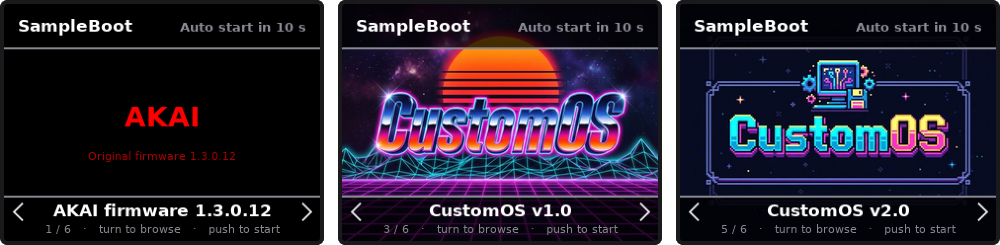
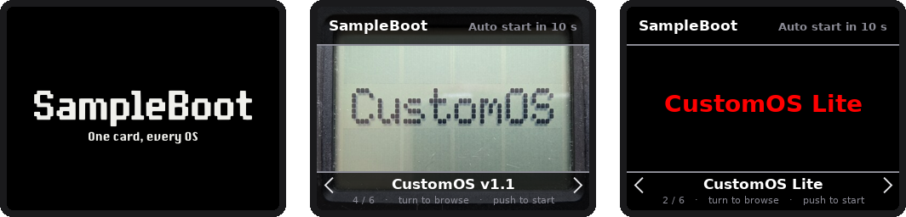
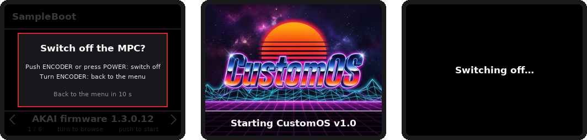
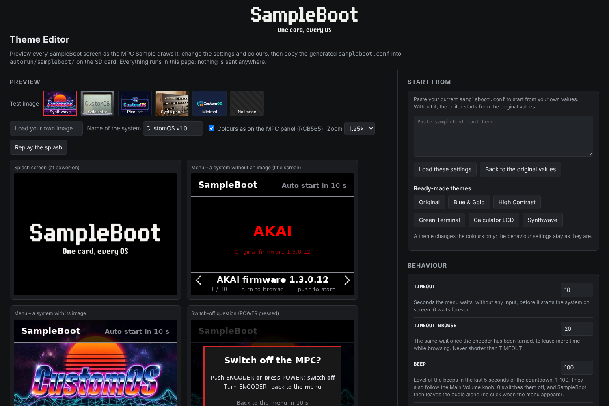

<h1 align="center">
  <picture>
    <source media="(prefers-color-scheme: dark)" srcset="docs/images/logo-light.svg">
    
  </picture>
</h1>

<p align="center"><b>A boot selector for the Akai MPC Sample</b></p>

<p align="center">
  <a href="https://sampleboot.com"><b>sampleboot.com</b></a> ·
  <a href="https://github.com/pxcm/SampleBoot/releases/latest">Download</a> ·
  <a href="https://sampleboot.com/theme-editor.html">Theme editor online</a> ·
  <a href="ROADMAP.md">Roadmap</a> ·
  <a href="https://ko-fi.com/paxicom">Support on Ko-fi</a>
</p>



SampleBoot is a boot menu for the **Akai MPC Sample**. Custom OSes for the MPC
Sample, such as [Melodee](https://github.com/keremimo/melodee-sample),
[SampQOL OS](https://github.com/snarebes/SampQOL-OS) and
[MPC Simple](https://sourceforge.net/projects/mpcsimple/), start from an `autorun`
folder on the SD card, and a card holds only one of them. To change OS you had
to swap SD cards, or move `autorun` folders around on a computer, and your
projects ended up spread over several cards.

With SampleBoot, **one SD card holds them all**: the stock firmware, every custom
OS and as many versions of each as you like. When the MPC starts, turn the
encoder, push it, and the system you chose starts. Your projects and samples
stay on the same card.

- It starts from the SD card. It does not change the stock firmware.
- Without the card, or with its `autorun` folder renamed, the MPC starts as
  stock.
- The stock Akai app is always one of the choices.
- Tested on the MPC Sample with firmware 1.3.0 (full version number 1.3.0.12).
  See [Works with](#works-with) for the systems known to work.
- SampleBoot includes no OS: you download each one from its own project.

## Features

**Boot menu**

- A splash screen at power-on, drawn line by line as on an old screen: dark,
  light, your own image, or off.
- A full-screen carousel: turn the encoder to browse, push it to start.
- Every system shows its own image, or a title screen with its name.
- Starts the system on screen by itself after 10 seconds (20 once you browse),
  with beeps in the last 5 seconds that follow the Main Volume knob. The last
  choice comes first next time.
- Press POWER in the menu to switch the MPC off.
- The pad and button lights left on by the previous app are switched off.

**One card, many systems**

- Add an OS by copying its `autorun` folder into `autorun/mods/`. No tools, no
  computer setup.
- Keep several versions of the same OS and go back to an older one in a few
  seconds.
- Give each system a name and an image, or hide it without deleting it.

**Safety**

- If a system does not start within 60 seconds, the stock app starts instead.
- Every audio setting it touches is put back before the chosen system starts.
- `last-boot.log` on the card tells what happened at the last boot, and
  `boot-history.log` keeps the last 10 boots, each with its date.

**Your look**

- Every colour on screen can be changed in `sampleboot.conf`.
- The **theme editor**, a page that runs offline in your browser, previews every
  screen exactly as the MPC draws it and writes the file for you.

<p align="center">
  <br>
  
</p>

## Works with

SampleBoot runs each system's own `autorun` folder, unchanged, so any OS that
starts from `autorun` should work. These are the ones known to work so far.

| System | Versions | Status | Checked by | Notes | From |
|---|---|---|---|---|---|
| Stock firmware | 1.3.0 (1.3.0.12) | Works | Tested | | Akai Professional |
| SampQOL OS | 0.1.4.7 – 0.3.0 | Works | Tested | 16 USB outputs: SampleBoot 1.0.1 or later | [beatops.io/sampqol](https://beatops.io/sampqol) |
| Melodee | 0.1.0 – 0.3.0 | Works | Tested | Update it by replacing its folder | [keremimo/melodee-sample](https://github.com/keremimo/melodee-sample) |
| MPC Simple | 1.0 Beta 1 – Beta 3 | Works | Tested | | [mpcsimple.com](https://mpcsimple.com/) |
| MPCTRACKER | 0.1.0 | Works | Tested | Needs an empty `sampleboot.inplace` file in its folder (SampleBoot 1.0.2 or later) | [jeffwebb-to/mpc-sample-tracker](https://github.com/jeffwebb-to/mpc-sample-tracker) |
| ODDFORM | 1.2.0 beta | Works | User report | | – |

*Works with issues* means it starts, but something doesn't work as it does
without SampleBoot: the notes say what. *Tested*: on the author's MPC Sample.
*User report*: a user confirmed it works.
Using another system with SampleBoot? Open an
[issue](https://github.com/pxcm/SampleBoot/issues) with its name and version,
and it goes on the list.

## Requirements

- Akai MPC Sample with firmware 1.3.0 (1.3.0.12)
- An SD card, and a computer to copy files to it
- The custom OSes you want, downloaded from their own projects
- Optional: Python 3, for the helper script

## Install

**Back up your SD card first.**

1. Download `SampleBoot-1.0.2.zip` from
   [Releases](../../releases) and unzip it.
2. Copy its `autorun` folder to the top level of the SD card.
   If the card already has an `autorun` folder from an OS, move that folder
   aside first: it becomes one of your systems in the next step.
3. For each OS, copy the `autorun` folder from its release into
   `autorun/mods/` and rename it to the name you want in the menu. If the OS
   also comes with a folder for the top level of the card (MPC Simple's
   `MPC-Simple`), copy that one to the top level, as its instructions say.
4. Put the card in the MPC and switch it on.

The card then looks like this:

```text
autorun/
  autorun.sh  autorun.json  autorun.check   SampleBoot's launcher, do not edit
  sampleboot/                               SampleBoot itself and its settings
  mods/
    Melodee 0.3.0/       Melodee's "autorun" folder, renamed
    SampQOL 0.3.0/       SampQOL's "autorun" folder, renamed
```

To add, update or remove an OS later, copy, replace or delete its folder in
`autorun/mods/`. A folder whose name starts with `_` is hidden from the menu.

### Updating SampleBoot

Copy the new release's `autorun` folder over the old one. Your systems in
`mods/` stay. Copying replaces `sampleboot/sampleboot.conf` too: if you changed
it, keep a copy and put it back.

### Helper script (optional)

`tools/add_mod.py` (Python 3, nothing else needed) installs or updates
SampleBoot without touching your settings, and adds OSes straight from their
release zips, top-level folders included:

```sh
python3 tools/add_mod.py /Volumes/MPC ~/Downloads/Melodee-MPC-Sample-v0.3.0.zip
python3 tools/add_mod.py /Volumes/MPC some-os.zip --name "Some OS 1.0"
python3 tools/add_mod.py /Volumes/MPC              # install or update SampleBoot only
```

## Using it

| Control | Action |
| --- | --- |
| Turn the **encoder** | Browse the systems |
| Push the **encoder** | Start the system on screen |
| No input for 10 s (20 s once you have browsed) | Start the system on screen |
| **POWER** | Ask whether to switch the MPC off: push the encoder or press POWER again to confirm, turn the encoder to go back |

SampleBoot appears a few seconds after power-on: the stock app starts first,
then SampleBoot takes over the screen, as Melodee and SampQOL do. Its splash
screen comes first; turn or push the encoder to skip it.

<p align="center"></p>

The countdown beeps come from the speaker, or only from the headphones or line
out when something is plugged in. Their volume follows the Main Volume knob.

## Names and images

- **Name:** the folder name, or the first line of a text file `sampleboot.txt`
  in the folder.
- **Image:** `sampleboot.png`, `sampleboot.jpg` or `sampleboot.bmp` in the
  folder, any size; 320×240 looks best. Keep the top and bottom 46 pixels free of
  important details: the menu bars cover them. `autorun/mods/_template/` holds
  an example that marks those areas. SampQOL's own splash screen is picked up
  by itself. Without an image, a title screen with the name is shown.
- **Stock entry:** the same files in `autorun/sampleboot/`.

### Systems that need to run from `autorun/`

A few systems work out where the card is from their own folder, and get it
wrong from `autorun/mods/`: their file browser stays inside `autorun/mods/`,
or they don't find their files. Put an empty file named `sampleboot.inplace`
in the system's folder: SampleBoot then runs it from `autorun/` itself, as if
it were alone on the card. Nothing on the card is moved.
**MPCTRACKER** needs this file. If you make a system for the MPC Sample, see
[the notes for OS authors](docs/OS-AUTHORS.md).

## Settings and colours

`autorun/sampleboot/sampleboot.conf`:

| Setting | Default | |
| --- | --- | --- |
| `TIMEOUT` | 10 | Seconds without input before the system on screen starts (0 = wait forever) |
| `TIMEOUT_BROWSE` | 20 | The same, once the encoder has been turned |
| `BEEP` | 100 | Level of the countdown beeps, 1–100, scaled by Main Volume (0 = no beeps) |
| `GRACE` | 60 | Seconds a system gets to start before the stock app starts instead |
| `BOOT_HISTORY` | 10 | Boots whose logs are kept in `boot-history.log`, each with its date; 0 = none |
| `ROOT_FILES` | `"mpcqol.conf"` | Settings files an OS keeps at the card root and reads from the folder above its own; SampleBoot shows them in `autorun/mods/` too (SampQOL's 16 USB outputs need this) |
| `SPLASH` | `"dark"` | Splash screen: `"dark"`, `"light"`, `"off"`, or a name of your own to show `splash-<name>.png` (320×240) from `autorun/sampleboot/` |
| `SPLASH_TIME` | 2 | Seconds the splash stays on screen; turning or pushing the encoder skips it |

The rest of the file sets every colour on screen, and the opacity of the bars,
as `"#RRGGBB"`. `sampleboot.original.conf`, next to it, keeps the original values.
The MPC Sample's panel shows 65,536 colours (16-bit RGB565), so each colour is
rounded to the nearest of them.

### Theme editor



`tools/theme-editor.html` is a single page that works offline, in any browser,
and sends nothing anywhere:

- previews every SampleBoot screen exactly as the MPC draws it, over test
  images or an image of your own, and plays the splash screen;
- has a colour picker and a short explanation for every setting, and
  ready-made themes;
- reads your current `sampleboot.conf` (paste it in) and writes the whole new file,
  ready to copy or download.

## Known behaviour

- **Small clicks with the volume up.** The stock firmware itself clicks after
  the start-up animation and when the SD card screen closes, with or without
  SampleBoot. When SampleBoot's menu appears, opening the audio for the
  countdown beeps can click slightly. It is kept as small as possible but not
  fully avoidable. With `BEEP=0` SampleBoot leaves the audio alone and that
  click is gone, together with the beeps.
- **Melodee's on-device updater** (release zip on the card, B3 INSTALL) refuses
  to update while SampleBoot is installed, without changing anything. Replace
  Melodee's folder in `autorun/mods/` instead.

## Troubleshooting

- Read `autorun/sampleboot/last-boot.log` on the card: it describes the last boot.
  `boot-history.log`, next to it, has the boots before, oldest first.
- If the MPC hangs, hold POWER until it switches off, remove the card and
  rename its `autorun` folder to `autorun-off`. The MPC then starts as stock.
- Folder names may contain spaces. If an OS does not start from such a folder,
  rename the folder without spaces and put the name in `sampleboot.txt`.
- To report a problem, open an [issue](../../issues) and attach
  `last-boot.log`.

## Build from source and technical notes

How SampleBoot works on the device, the files it uses and how to build it:
[docs/TECHNICAL.md](docs/TECHNICAL.md).

## Credits and licence

SampleBoot is by Alessandro "Paxi" D'Esposito ([pxcm](https://github.com/pxcm)),
under the [MIT licence](LICENSE).

- The control surface map, the display and audio details and the autorun
  signature come from the research published by
  [sample-base](https://github.com/keremimo/sample-base) (keremimo, the author
  of Melodee) and the mpc-sample-plugins project. Thank you.
- [Melodee](https://github.com/keremimo/melodee-sample),
  [SampQOL OS](https://github.com/snarebes/SampQOL-OS) and
  [MPC Simple](https://sourceforge.net/projects/mpcsimple/) belong to their authors.
  SampleBoot ships none of their files.
- [stb_image](https://github.com/nothings/stb) by Sean Barrett (public domain / MIT).
- DejaVu Sans font (DejaVu fonts licence).
- The "CustomOS" test images are made-up logos generated with Magnific.
- SampleBoot logo by Alessandro "Paxi" D'Esposito.

SampleBoot is an independent project, not affiliated with or endorsed by
inMusic Brands or Akai Professional. Akai Professional, MPC and MPC Sample are
trademarks of inMusic Brands, Inc., used here only to say which device
SampleBoot is made for.
